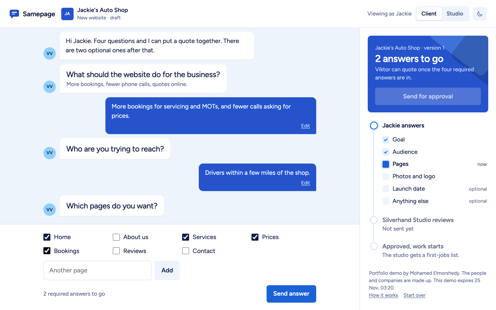
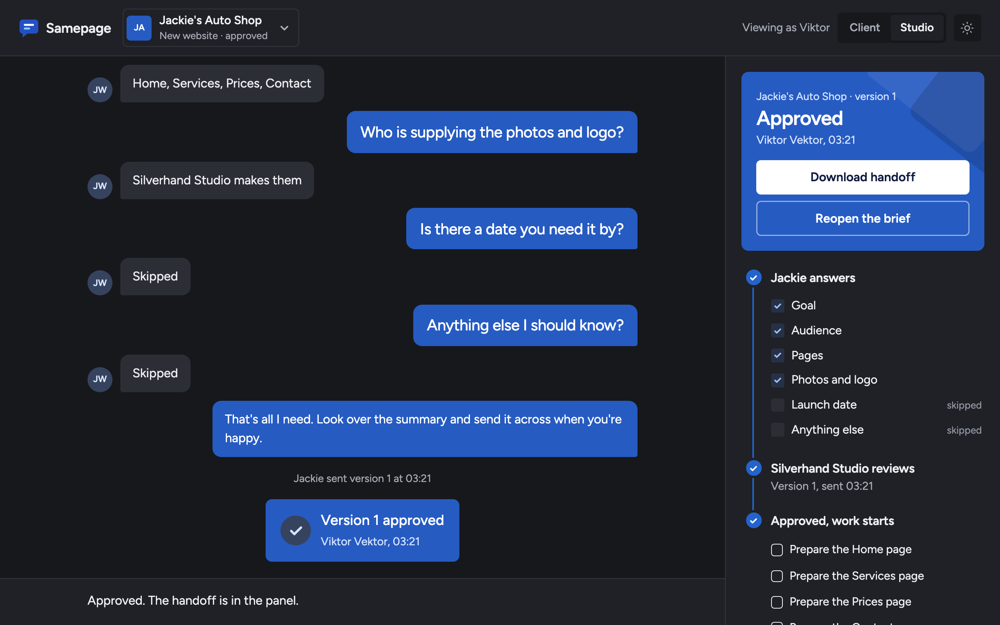
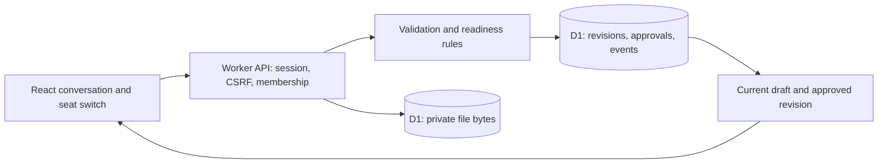

# Samepage

Website briefs for studios and their clients, done as a chat.

A studio asks a client six questions in a thread. The client answers one at a time and sends the brief. The studio approves one version or sends it back with a note, and an approved brief becomes a handoff with a first-jobs list.

**[Try the live demo](https://samepage.mosalah-77.workers.dev)** · [Watch the one-minute walkthrough](https://samepage.mosalah-77.workers.dev/walkthrough.mp4) · [How it works](docs/how-it-works.md) · [Decisions](docs/decisions.md) · [Testing](docs/testing.md)





A one-minute walkthrough of both seats:

https://github.com/user-attachments/assets/f7570f14-5ad3-48ff-b76e-0b978d9fdb41

This is a portfolio project. The people and companies in it are made up, nobody commissioned it, and I am not claiming users or results. I built it with AI assistance, which I describe [below](#how-i-built-it).

## Try it

1. Start a demo. You are Jackie, the client. Answer the four required questions. The two optional ones can be skipped.
2. Choose **Send for approval**, then switch the seat at the top right to **Studio**. You are now Viktor.
3. Choose **Ask for changes** and write a note. Switch back to **Client**, change an answer with its **Edit** link and send version 2.
4. As the studio, approve version 2 and download the handoff.
5. Still as the studio, open the project menu and pick Marsh Lane Vets. Switch to **Client** and the menu is gone: Jackie's seat belongs to one project, and the server refuses the other.

Switching seats stands in for signing in as someone else. Everything behind it is real: the database, the file storage and the permission checks all run on the server.

## What is worth a look

- **One client cannot see another's work.** Every read and write is scoped through workspace membership on the server. A request for someone else's project or file gets the same 404 as one that does not exist. [`lib/workflow.ts`](lib/workflow.ts), [`tests/api.test.mjs`](tests/api.test.mjs)
- **Two saves at once cannot overwrite each other.** Each change carries the version token it last saw, and the check happens inside the same SQL batch as the write. One save wins and the other gets a 409.
- **A retry cannot save twice.** Each change carries a retry key. If the reply is lost and the browser tries again, the server returns the first result.
- **Approval names one stored revision.** Every answer is an immutable row. The handoff reads the approved revision even when a newer draft exists.
- **The conversation is not stored anywhere.** The thread, the version number and the status are worked out from the saved project, so a reload and the other seat always agree. [`lib/conversation.ts`](lib/conversation.ts)
- **Uploads survive failures.** A file reserves its space before the bytes are written, and choosing the same file again resumes a failed upload. [`lib/assets.ts`](lib/assets.ts)
- **Basic hardening for a public demo.** A content security policy and related headers, CSRF and origin checks, per-visitor rate limits, bounded storage and a clean production dependency audit.

## Stack

React 19 and TypeScript on [vinext](https://github.com/cloudflare/vinext) (the Next.js App Router API on Vite), running as one Cloudflare Worker with a D1 database. Uploaded files are stored in D1 too. Plain CSS, one self-hosted font and no UI library. Everything runs on Cloudflare's free plan.



## Run it locally

Needs Node.js 22.13 or newer.

```sh
npm run install:ci
npm run build
for f in drizzle/*.sql; do
  node --import ./scripts/sites-env.mjs ./node_modules/wrangler/bin/wrangler.js d1 execute DB --local \
    --config dist/server/wrangler.json --persist-to .wrangler/state --file "$f"
done
npm start -- --port 5180
```

Apply the migrations once. `npm run dev -- --port 5179` runs the development server against the same local database.

## Test it

```sh
npm run typecheck
npm run lint
npm test
```

There are 35 unit checks and 16 API checks. The API checks run against the built Worker with a throwaway local database. They cover access between visitors and between clients, invalid input, saves that race each other, safe retries, upload failure and recovery, approval, reset and cleanup. [Testing](docs/testing.md) has the browser, accessibility and security checks, and what was not checked.

## Deploy your own

It is one Worker and one D1 database. Sign in with Wrangler, create a D1 database, put its ID in `vite.config.ts`, apply the migrations with `--remote` in place of `--local --persist-to .wrangler/state`, then run `npm run build` and `npm run deploy`. [Operator notes](docs/operator.md) cover the cleanup token and the storage limits.

## Limits

- It is a demo. There are no accounts, invitations, emails or payments, and switching seats is not authentication.
- The site holds at most 20 demos at a time. A demo expires after 24 hours or when the visitor leaves it, and an hourly job removes expired ones. Rate limits slow abuse of that cap but do not prevent it.
- A file can be at most 1.9 MB, because its bytes live in a D1 row. Files get size, type and signature checks, not a virus scan.
- An answer that has not been sent lives in the page and is lost on reload.
- No one has tested it with a screen reader or on a real phone. The automated accessibility scan is clean.

## How I built it

I built Samepage with AI assistance. The assistants wrote most of the code, the tests and the first drafts of these documents, in the first version and in the November 2026 rebuild that brought the conversation interface, the move to Cloudflare and the security work.

My part was deciding what to build and holding it to a standard. I set the scope, chose the stack, and went through several rounds of design, throwing out the ones that did not work. I reviewed what came back, caught problems such as a client being able to see the whole project list, and decided what shipped.

## Credits

Figtree is used under the SIL Open Font License. The project started from a vinext starter template. Some of the demo names are a nod to Cyberpunk 2077. Details are in [ATTRIBUTION.md](ATTRIBUTION.md). I have not chosen a licence for my own code yet.
