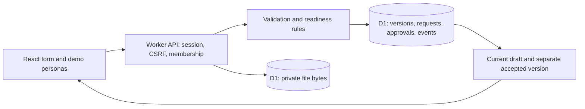

# Client Brief

An independent portfolio prototype by Mohamed Elmorshedy, built with AI assistance. Two fictional clients and an agency owner turn an incomplete website brief into an approved version and a useful handoff. This is not commissioned work or evidence of paying clients, adoption or time saved.

[Open the public demo](https://client-brief.mosalah-77.workers.dev) · [Browse the core logic](https://github.com/mosalah-77/onboarding-portal/tree/main/lib) · [How it works](https://client-brief.mosalah-77.workers.dev/how-it-works)

The demo runs on the Cloudflare Workers free plan. The hosted workflow, access boundaries and a file round trip were checked there on 23 November 2026; see [verification](docs/verification.md).

## Try the workflow

1. Start a demo as Client A. The **Next step** card says one thing is left: the audience is missing, so submission is blocked.
2. Enter an audience and save. Constraints and deadline can stay blank.
3. Submit the saved version. Choose **Continue as agency owner** on the card (or use **Viewing as** in the side rail) and approve that exact version.
4. Read the approved facts and suggested delivery checklist. Reopen with a reason to make a new revision; the previous approval stays in history.
5. As the owner, copy Client B's project URL. Switch to Client A and open it: the server denies access.

Persona switching simulates roles within one visitor's isolated run. It is not production customer authentication. Use synthetic text and files only. Runs expire after 24 hours.

## What works

- D1-backed projects, immutable brief versions, rule-based missing inputs and request comments.
- Owner approval of an exact submitted version, recorded reopening reasons, activity history and downloadable handoff.
- A scheduling reminder when the accepted brief has no deadline. The date remains optional; an entered date produces a task to review it.
- Private file uploads, stored in D1, with membership checks on every download, bounded storage and recoverable retries.
- Server-side permission, concurrency, validation and idempotency checks. The browser keeps unsaved inputs after failed saves and warns before navigation.
- A next-step card that names what is left and who acts, a three-way role switcher, and a brief form grouped under plain headings.
- Responsive layouts, keyboard focus, linked field errors and an in-app explanation at `/how-it-works`. Motion is short and CSS-only, and is switched off for visitors who ask for reduced motion.
- A softer light mode and a dark mode. The first visit follows the system setting; a button in the top bar switches and remembers the choice.
- Operator-triggered expired-run cleanup. It deletes stored files before releasing their SQL quota.

There are no real invitations, email sending, invoices, contracts, payments or runtime AI calls. The checklist is a deterministic suggestion for human review.

## Run locally

Requires Git and Node.js 22.13 or newer; verified here with Node 26.6.0. Use the lockfile:

```sh
npm run install:ci
npm run build
```

For a fresh local database, apply the three migrations once, in order:

```sh
node --import ./scripts/sites-env.mjs ./node_modules/wrangler/bin/wrangler.js d1 execute DB --local --config dist/server/wrangler.json --persist-to .wrangler/state --file drizzle/0000_premium_gravity.sql
node --import ./scripts/sites-env.mjs ./node_modules/wrangler/bin/wrangler.js d1 execute DB --local --config dist/server/wrangler.json --persist-to .wrangler/state --file drizzle/0001_acoustic_hannibal_king.sql
node --import ./scripts/sites-env.mjs ./node_modules/wrangler/bin/wrangler.js d1 execute DB --local --config dist/server/wrangler.json --persist-to .wrangler/state --file drizzle/0002_yielding_warhawk.sql
npm run dev -- --port 5179
```

Use the loopback URL printed by the server. Do not replay migrations already applied. `.wrangler/state` holds local data; the test runner uses separate disposable state. `npm start -- --port 5180` previews the built Worker.

## Deploy

The demo is one Cloudflare Worker with one D1 database, both on the free plan. `vite.config.ts` names the Worker and the database. To publish a separate copy, sign in with Wrangler, create your own D1 database, put its ID in `vite.config.ts` and apply the three migrations with `--remote` in place of `--local --persist-to .wrangler/state`. Then:

```sh
npm run build
npm run deploy
```

Set `DEMO_ADMIN_TOKEN` as a Worker secret before running cleanup; see [operator instructions](docs/operator.md).

## Verify

```sh
npm run typecheck
npm run build
npm test
```

The current suite contains 32 unit, storage-fault and client checks plus 15 real Worker API checks. The API runner applies all migrations to disposable local D1 state. It checks access boundaries, invalid inputs, conflicting saves/approvals, safe retries, upload failure recovery, reset and cleanup. See [observed results and limits](docs/verification.md).

## Follow the data



Start with [the learner's walkthrough](docs/how-it-works.md), then [the code graph guide](docs/code-graph.md). Graphify is an optional local developer tool; `npm run graph` refreshes its AST graph without model calls or code upload. SQL-string relationships still need source inspection. Read [decisions](docs/decisions.md), [issues](docs/issues.md), [design review](docs/design-review.md) and [operator instructions](docs/operator.md) for maintenance.

## Limits and contribution record

The public demo stores at most 20 runs, including expired runs until cleanup; it has no per-IP rate limiter. Cleanup is manual. An interrupted upload can leave a durable write claim that requires operator investigation; capacity stays reserved until it is safely repaired. Unsaved form edits live in memory, not durable browser storage. Uploaded files receive size, type and signature checks, not malware scanning. A file can be at most 1.9 MB because its bytes are stored in a D1 row.

Mohamed built this project using AI coding assistants as tools: GPT/Codex for the first version and Claude for the 23 November 2026 interface, theme, reliability and hosting work. He set the scope, chose the stack and visual direction, directed and reviewed the work, and made the predictions recorded in [learning](docs/learning.md). The assistants generated most of the implementation, tests and documentation, and AI review passes checked the design and code. He also completed a guided code change himself: the deadline reminder and its two tests, with the checks run and the result confirmed on screen and in the downloaded handoff. Not every line was written unaided; see [decisions](docs/decisions.md) for the reasoning behind the main choices.

Third-party notices remain in [ATTRIBUTION.md](ATTRIBUTION.md) and the referenced licence files. No separate licence has yet been selected for the original project code. No Halvern client material or Quin's code was used.
