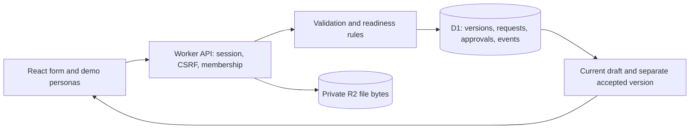

# Client Brief

An independent portfolio prototype by Mohamed Elmorshedy, built with AI assistance. Two fictional clients and an agency owner turn an incomplete website brief into an approved version and a useful handoff. This is not commissioned work or evidence of paying clients, adoption or time saved.

[Open the public demo](https://elmorshedy-onboarding-demo.m-elmorshedy635.chatgpt.site) · [Read the source](https://github.com/mosalah-77/onboarding-portal) · [How it works](https://elmorshedy-onboarding-demo.m-elmorshedy635.chatgpt.site/how-it-works)

The hosted workflow and access-boundary checks passed on 8 November 2026; see [verification](docs/verification.md).

## Try the workflow

1. Start a demo as Client A. The audience is missing, so submission is blocked.
2. Enter an audience and save. Constraints and deadline can stay blank.
3. Submit the saved version, switch to Agency owner and approve that exact version.
4. Read the accepted facts and suggested delivery checklist. Reopen with a reason to make a new revision; the previous approval stays in history.
5. As the owner, copy Client B's project URL. Switch to Client A and open it: the server denies access.

Persona switching simulates roles within one visitor's isolated run. It is not production customer authentication. Use synthetic text and files only. Runs expire after 24 hours.

## What works

- D1-backed projects, immutable brief versions, rule-based missing inputs and request comments.
- Owner approval of an exact submitted version, recorded reopening reasons, activity history and downloadable handoff.
- Private R2 uploads with membership checks on every download, bounded storage and recoverable retries.
- Server-side permission, concurrency, validation and idempotency checks. The browser keeps unsaved inputs after failed saves and warns before navigation.
- Responsive layouts, keyboard focus, linked field errors and an in-app explanation at `/how-it-works`.
- Operator-triggered expired-run cleanup. It deletes stored files before releasing their SQL quota.

There are no real invitations, email sending, invoices, contracts, payments or runtime AI calls. The checklist is a deterministic suggestion for human review.

## Run locally

Requires Git and Node.js 22.13 or newer; verified here with Node 26.6.0. Use the lockfile:

```sh
npm run install:ci
npm run build
```

For a fresh local database, apply both migrations once, in order:

```sh
node --import ./scripts/sites-env.mjs ./node_modules/wrangler/bin/wrangler.js d1 execute DB --local --config dist/server/wrangler.json --persist-to .wrangler/state --file drizzle/0000_premium_gravity.sql
node --import ./scripts/sites-env.mjs ./node_modules/wrangler/bin/wrangler.js d1 execute DB --local --config dist/server/wrangler.json --persist-to .wrangler/state --file drizzle/0001_acoustic_hannibal_king.sql
npm run dev -- --port 5179
```

Use the loopback URL printed by the server. Do not replay migrations already applied. `.wrangler/state` holds local data; the test runner uses separate disposable state. `npm start -- --port 5180` previews the built Worker. The tracked `.openai/hosting.json` identifies Mohamed's Site; create your own Site and replace its project ID before publishing a separate copy.

## Verify

```sh
npm run typecheck
npm run build
npm test
```

The current suite contains 30 unit, storage-fault and client checks plus 15 real Worker API checks. The API runner applies all migrations to disposable D1/R2 state. It checks access boundaries, invalid inputs, conflicting saves/approvals, safe retries, upload failure recovery, reset and cleanup. See [observed results and limits](docs/verification.md).

## Follow the data



Start with [the learner's walkthrough](docs/how-it-works.md), then [the code graph guide](docs/code-graph.md). Graphify is an optional local developer tool; `npm run graph` refreshes its AST graph without model calls or code upload. SQL-string relationships still need source inspection. Read [decisions](docs/decisions.md), [issues](docs/issues.md), [design review](docs/design-review.md) and [operator instructions](docs/operator.md) for maintenance.

## Limits and contribution record

The public demo stores at most 20 runs, including expired runs until cleanup; it has no per-IP rate limiter. Cleanup is manual. An interrupted upload can leave a durable write claim that requires operator investigation; capacity stays reserved until it is safely repaired. Unsaved form edits live in memory, not durable browser storage. Uploaded files receive size, type and signature checks, not malware scanning.

Mohamed supplied the scope, chose the stack and visual direction, and made the predictions recorded in [learning](docs/learning.md). GPT/Codex generated most implementation, tests and documentation with Mohamed's direction. Independent AI agents reviewed the design and code. Mohamed's own documented code variation is still pending. GitHub publication uses his account without an AI contributor or co-author entry; that does not mean every line was written unaided.

Third-party notices remain in [ATTRIBUTION.md](ATTRIBUTION.md) and the referenced licence files. No separate licence has yet been selected for the original project code. No Halvern client material or Quin's code was used.
