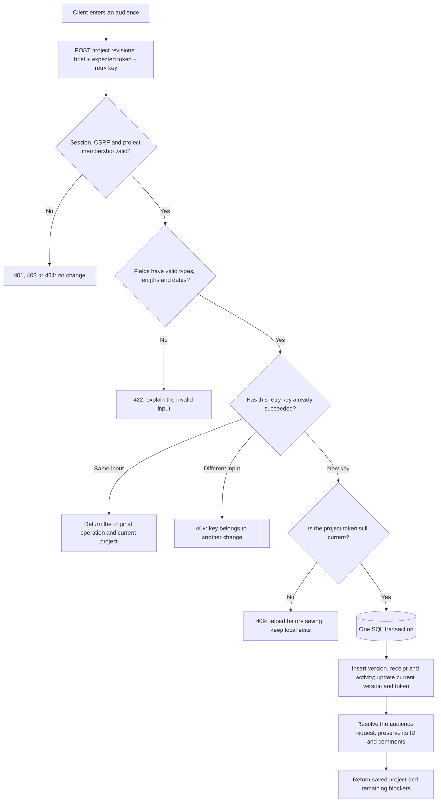
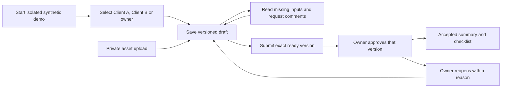
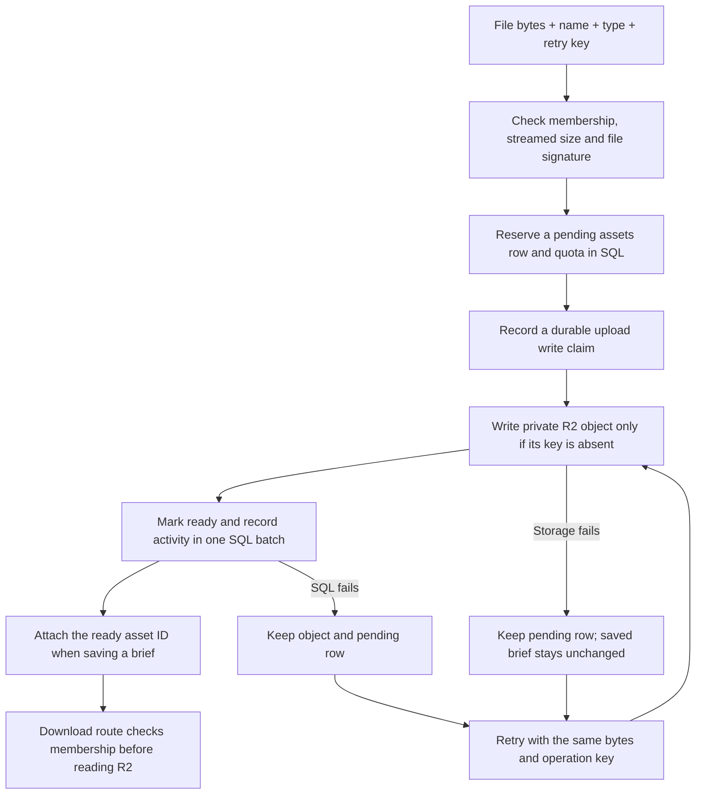
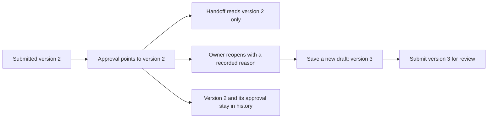
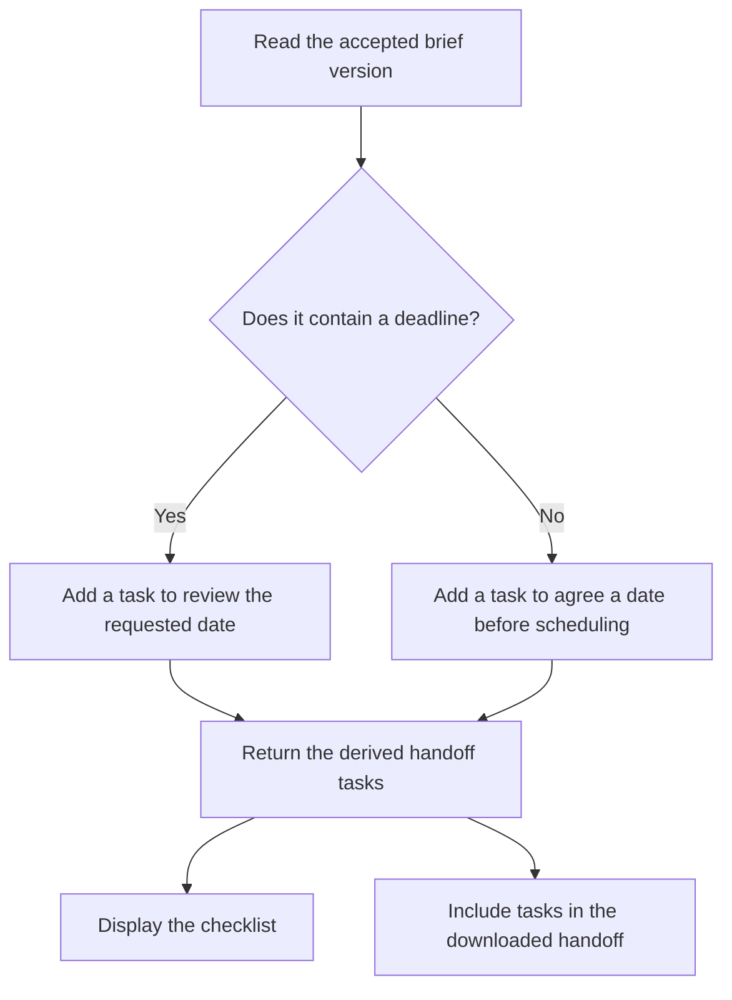
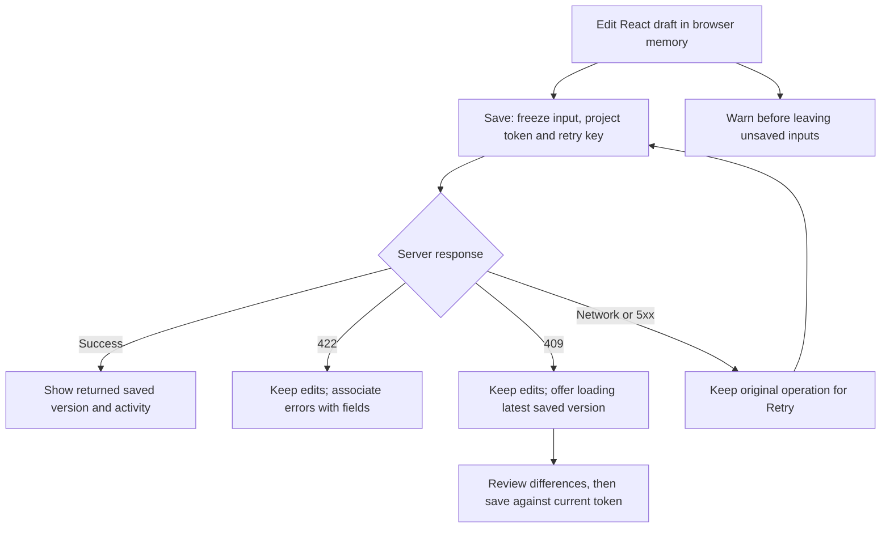
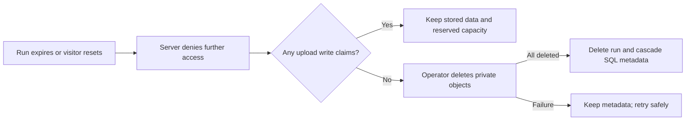

# How a brief moves through the portal

Author: GPT/Codex. Updated 8 November 2026, including Mohamed's guided deadline-reminder change.

This is Mohamed's project guide. Start with one action and follow its value into storage. The diagrams describe observable code and design decisions. The browser workflow and backend are implemented. Deployment verification is recorded separately.

## Follow one change

Imagine Client A enters “Local residents” in the audience field. Saving creates another version of the brief. The previous version stays in the database, so a later approval can point to an exact record.

The server accepts an incomplete draft. Submission is stricter: goal, audience, pages and an asset plan must be present. Choosing supplied assets requires a ready file. Required owner requests must be resolved. Constraints and the requested deadline are optional, so leaving them blank does not block submission.

## The whole workflow

Persona switching is a demo facility. It demonstrates the three roles within your synthetic run; it is not real customer authentication. Another browser's run has different workspaces and projects. Client A's membership grants access only to A's workspace, even if A guesses B's project URL.

## Where the information lives

| Information | Storage | Why it exists |
| --- | --- | --- |
| Browser identity | HttpOnly cookie; only its hash is stored in `sessions` | The server identifies the current run and persona without putting an identity secret in page JavaScript. |
| Access boundary | `runs`, `workspaces`, `memberships`, `projects` in D1 SQL | Each read and write must reach a permitted project. |
| Brief content | A new `versions` row on each save | Historical content is preserved. `projects.latest_revision_id` identifies the current draft. |
| Missing inputs and conversation | `requests` and `comments` | Automatic rule keys keep one request per missing field; comments survive resolution and reopening. |
| Safe retry | `receipts` | The same operation key and input return the previous operation instead of creating it again. |
| Audit history | `events` | Each successful workflow change records who acted and what changed in the same transaction. |
| Approval | `approvals` and accepted-version pointer | Approval refers to a specific immutable version. |
| Uploaded bytes | Private R2 objects; metadata in `assets` | File access passes through the same membership boundary. |

D1 stores structured records. R2 stores file bytes. React displays the server's result. The browser is never the authority for permissions, readiness or approval.

## Find the code and its proof

| Question | Read this code | Check this evidence |
| --- | --- | --- |
| What makes a brief ready? | [`lib/brief.ts`](../lib/brief.ts), `readiness` | [`tests/brief.test.mjs`](../tests/brief.test.mjs): optional blanks, missing audience, duplicate pages, invalid date |
| What happens when no deadline is entered? | `checklist` in [`lib/brief.ts`](../lib/brief.ts) | Brief tests: blank date adds a scheduling reminder; an entered date keeps exactly one requested-date task |
| Who is making the request? | [`lib/session.ts`](../lib/session.ts), `requireActor` | [`tests/api.test.mjs`](../tests/api.test.mjs): another visitor cannot read the project |
| Why can't A open B's brief? | [`lib/workflow.ts`](../lib/workflow.ts), `projectRow` | API test: Client A cannot access Client B |
| Why doesn't a retry create two versions? | `existingOperation` and `mutate` in workflow | API test: lost-response retry returns the same revision |
| What happens when two saves race? | `mutate`: conditional token check inside the transaction | API test: one 200 success and one 409 conflict |
| How do field requests stay connected to comments? | `syncRuleRequests` in workflow | API test: automatic request resolves and reopens with the same ID and comment |
| What happens at the HTTP boundary? | [`lib/http.ts`](../lib/http.ts) | API tests: missing CSRF and malformed input fail |

The checked behaviour is recorded in [verification](verification.md). A passing test establishes the scenario it ran; it does not establish every possible failure case.

## A learning checkpoint you can use

Before changing the audience rule, locate `readiness`. Explain which input it receives, what it returns, and why it does not write to SQL itself. Then read the test for the missing audience and predict the result before running `npm run test:unit`.

This is a practice exercise, not a request to choose product requirements. It is fine to follow the example and ask for an explanation first. Mohamed completed the guided deadline-reminder variation described below; [the learning record](learning.md) distinguishes his edits and checks from AI assistance.

## Keeping this guide useful

When an implementation task changes the flow, update the matching diagram and evidence row in the same commit. Replace a planned arrow only after the behaviour has passed its check. [The code graph guide](code-graph.md) explains the supplementary graph used during maintenance.

## Follow a file upload

The pending row counts against capacity. A repeated successful upload returns the same file ID. Changing bytes while reusing its key returns 409. The file itself is immutable; a different file needs a new upload. A filename and signature check does not scan for malware. Use synthetic files only.

Read `lib/assets.ts`, `tests/assets.test.mjs` and the real R2 test in `tests/api.test.mjs` together to follow this path.

## Why reopening does not change the old agreement

The current draft and the accepted version are separate pointers. A new draft does not move the accepted pointer. Only a successful owner approval does. The transaction checks the project token before writing any approval, receipt or event, so a concurrent save or required request cannot slip into an already-checked approval.

The checklist is derived from the accepted facts: each page produces a task linked to that page entry. A blank deadline stays “Not agreed” and adds a task to agree a delivery date before scheduling work. A requested date is still a request, even in the handoff. Read `approveBrief`, `reopenBrief` and `checklist` alongside `tests/approval.test.mjs`.

## How the deadline becomes a checklist task

`checklist(accepted)` receives the accepted brief and returns an array of task objects. Each has an ID, visible text and a source field for its fact link. This function writes nothing to storage. A blank deadline remains `null` in the saved brief, displays as “Not agreed”, and does not block submission or approval. The generated reminder never chooses a date.

`lib/workflow.ts` calls the function when reading a project; `components/handoff.tsx` uses the returned tasks for both the screen and the text download. These are derived suggestions, so changing this rule also updates the checklist shown for an existing accepted brief. The saved facts and approval remain unchanged.

`tests/brief.test.mjs` imports `checklist` from `lib/brief.ts`. The JavaScript test describes the expected output; the TypeScript file implements it. Mohamed first ran a failing blank-date test, edited the empty branch of the condition, and reran it successfully. A second test checks that an entered date still produces exactly one deadline task.

## Follow a failed save in the browser

`components/portal.tsx` owns the editor state and pending action. `reconcileEditor` in `lib/client.ts` keeps the draft, baseline, revision identity and concurrency token together. A response containing a newer revision refreshes a clean editor; genuinely unsaved edits stay visible with their earlier version identified, and approval remains disabled until they are reconciled. `lib/client.ts` sends the request and returns structured errors. A retry uses the same operation key and input. The component's load generation also rejects an outdated response; a 20-second delayed GET check confirmed that navigating away cancels the old view and preserves the new project’s unsaved input. Navigation controls are disabled while a load is pending. This does not separately unit-test every generation-guard branch. Unsaved text is not durable across closing the browser.

## Expiry, reset and cleanup

An upload releases its claim after its storage attempt ends. If the Worker terminates first, an operator must investigate the remaining claim. This fails closed: it holds capacity instead of risking an orphan file. Read `lib/cleanup.ts`, `tests/cleanup.test.mjs` and [operator instructions](operator.md). At most 20 runs remain stored, including expired runs waiting for cleanup.
